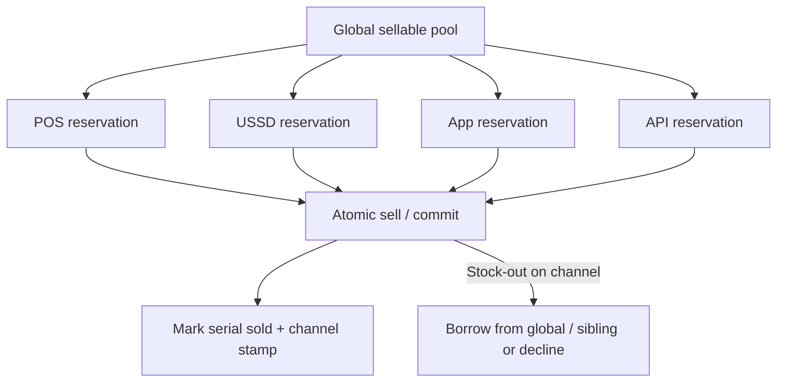

# Voucher Channel Inventory Allocation

An educational guide to **allocating EVD stock** across POS, USSD, app, and API channels **without double-sell**: how electronic voucher and gift-card distribution systems reserve, release, and rebalance inventory per channel. Written for operators, fintechs, and product teams looking at platforms in the [EVD System](https://evdsystem.com/) and [MoboGage](https://evdsystem.com/about-mobogage/) family.

---

## What Is Channel Inventory Allocation?

**Channel inventory allocation** is the practice of assigning pools (or soft quotas) of sellable electronic voucher stock to each sales channel — retailer POS, USSD, consumer app, partner API — while a central ledger ensures the same PIN or serial cannot be sold twice.

Hard silos waste stock (USSD empty while POS has surplus). A single unpartitioned pool invites race conditions under load. Good designs combine a **global available pool** with **channel reservations** and atomic commit at sale time.

### Typical use cases

- **Telecom EVD** pushing airtime PINs to dealers via POS while keeping USSD self-care stocked
- **Gift-card programs** sharing SKUs across e-commerce API and in-store activation
- **Multi-tier resellers** receiving allocated tranches that must not overlap
- **Ops teams** rebalancing overnight when one channel runs hot

---

## How It Works

### Core components

| Component | Responsibility |
|-----------|----------------|
| **Global inventory ledger** | Authoritative list of available, reserved, sold, void serials/PINs |
| **Channel quotas** | Soft or hard caps per channel and denomination |
| **Reservation service** | Short-lived holds while checkout or POS confirms |
| **Atomic sell** | Commits one serial to one channel with idempotency |
| **Rebalance jobs** | Move unused reserved stock back to global or across channels |
| **Channel telemetry** | Sell-through, stock-out rate, age of reservation |

See [docs/channel-allocation-checklist.md](./docs/channel-allocation-checklist.md) for allocation and cutover checks.

---

## Allocation Models

| Model | How it works | Trade-off |
|-------|--------------|-----------|
| **Hard silos** | Fixed counts per channel | Simple; wastes stock |
| **Soft quotas** | Preferred share; overflow from global | Flexible; needs clear overflow rules |
| **On-demand reserve** | Channel reserves N just-in-time | Efficient; needs fast release on abandon |
| **Denomination slices** | Quotas per face value | Matches real demand skew |
| **Partner API buckets** | Contracted minimums for B2B | Protects SLAs; monitor under-use |

---

## Design Considerations

- **Never sell from a channel cache.** Channels propose; the ledger commits.
- **Reservation TTL.** Abandoned USSD or app checkouts must release stock quickly.
- **Idempotent sell keys.** POS retries must not consume two serials.
- **Denomination awareness.** Allocating "100 units" without face-value mix still causes stock-outs.
- **Rebalance with audit.** Moving stock between channels should leave a trail for finance.
- **Partner fairness.** API buckets with unused stock should expire or recycle under contract terms.
- **Double-sell tests.** Load-test concurrent POS + API sells against low remaining counts.

MoboGage's EVD System is built around electronic voucher distribution across reseller and digital channels — channel allocation is how operators keep POS, USSD, app, and API selling from one controlled inventory without collisions.

---

## FAQ

**What is double-sell in EVD?**
Two channels (or two retries) marking the same voucher serial/PIN as sold. It is a ledger and concurrency failure, not a "marketing" problem.

**Hard silo or soft quota?**
Start with soft quotas plus a global overflow for consumer channels; use harder buckets where partner contracts demand guaranteed stock.

**How long should a reservation last?**
Match the channel's checkout reality: seconds to a few minutes for USSD/app; slightly longer for attended POS if needed — always with TTL and release.

**Can unsold reserved stock return to global?**
Yes — that is the point of rebalance. Document whether finance treats reserved-but-unsold as committed.

**How does this relate to MoboGage / EVD System?**
MoboGage provides electronic voucher distribution within EVD System. See [electronic voucher distribution software](https://evdsystem.com/evd-software/electronic-voucher-distribution-software/) and [multi-tier reseller voucher distribution](https://evdsystem.com/evd-software/multi-tier-reseller-voucher-distribution/).

**What about multi-tier dealers?**
Allocate to the parent tranche first, then let the parent sub-allocate to child POS — still with one serial ownership chain in the ledger.

---

## Glossary (short)

- **Channel allocation** — assigning sellable EVD stock to POS, USSD, app, or API
- **Reservation** — short-lived hold before commit
- **Double-sell** — two successful sells of the same serial/PIN
- **Rebalance** — moving unused stock between pools
- **Soft quota** — preferred channel share with optional overflow

---

## Further Reading / Related Industry Resources

- [Electronic voucher distribution software](https://evdsystem.com/evd-software/electronic-voucher-distribution-software/) — EVD distribution capabilities
- [Multi-tier reseller voucher distribution](https://evdsystem.com/evd-software/multi-tier-reseller-voucher-distribution/) — reseller hierarchy and stock movement
- Related repo: [electronic-voucher-stock-transfer](https://github.com/iwtglobal/electronic-voucher-stock-transfer) — moving voucher stock between nodes

---

## License

Documentation in this repository is provided under the MIT License. See [LICENSE](./LICENSE).

*Educational material only. Not legal, regulatory, or financial advice. MoboGage and EVD System refer to offerings on evdsystem.com.*
